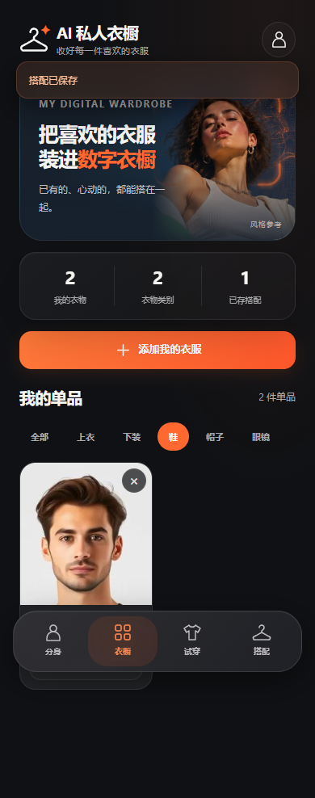
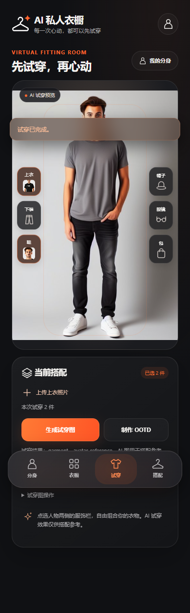
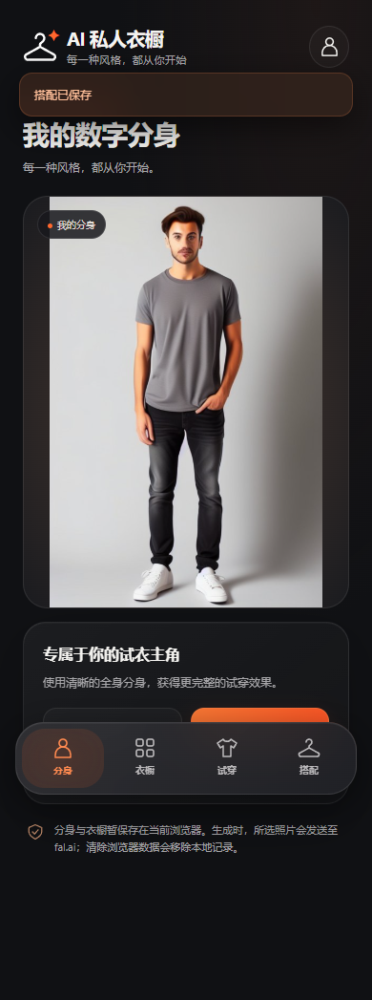

# TRY-ON · AI 私人衣橱

以自己的数字分身试穿已有或想买的衣服，管理私人衣橱，收藏搭配并导出 OOTD。

前端是一个 78 KB 的单页应用，后端是纯 Python 标准库的 HTTP 服务（`http.server`），唯一的必需依赖是 Pillow。没有数据库服务、没有 Web 框架、没有前端构建步骤：克隆下来 `pip install Pillow` 就能跑。

> English: A self-hosted AI fitting room. Digital-avatar try-on and a private wardrobe, built on the Python standard library with Pillow as the only hard dependency. Model providers (Volcano Ark Seedream, fal.ai) are pluggable and optional — without keys the UI still runs in browse-only mode.

## 功能

- **数字分身**：用一张照片生成可复用的分身，支持姿态、外观与身形描述
- **试穿**：上衣 / 下装 / 鞋 / 帽子 / 眼镜 / 包 六个槽位，可单件或整套
- **私人衣橱**：单品入库、搭配收藏、导出带水印的 OOTD 图
- **双模型路由**：Seedream 5.0 Flash（火山方舟）与 Nano Banana 2（fal.ai）可切换，前端记住选择
- **免登录试用**：留空短信配置时，浏览器用 HttpOnly Cookie 自动建立私有身份（换设备或清 Cookie 会丢失关联）
- **可选 Agent 聊天**：接入任意 OpenAI 兼容的 `/v1/chat/completions` 端点

## 快速开始

需要 Python 3.10+（推荐 3.11）。

```bash
pip install -r deploy/requirements.txt
python local/server.py --port 8765
```

打开 http://127.0.0.1:8765 。

Windows 也可以双击 `启动本地.ps1`：它会自建 `.venv`、安装依赖、读取 `.secrets/` 下的密钥（若有）并启动服务。

### 没有模型密钥时

界面、衣橱、分身库、导出全部可用；点击"生成"会返回 503 和提示语。这是预期行为，方便在没有 API 额度时开发前端。

## 配置

所有配置走环境变量，仓库里不含任何密钥。参考 `deploy/server.env.example`。

| 变量 | 作用 | 默认 |
|---|---|---|
| `ARK_API_KEY` | 火山方舟 Seedream 生图密钥 | 空（生图不可用） |
| `ARK_IMAGE_MODEL` | 方舟模型 ID | `doubao-seedream-5-0-flash-260915` |
| `FAL_KEY` | fal.ai 密钥（双模型切换用） | 空 |
| `APP_ORIGIN` | 对外 HTTPS 源，用于 CORS 与 Cookie | 空（本地放宽） |
| `SHIYI_DATA_DIR` | 账号与分身图片的持久目录 | `.secrets/accounts` |
| `TRYON_LLM_URL` / `TRYON_LLM_MODEL` / `TRYON_LLM_KEY` | Agent 聊天端点（OpenAI 兼容） | 空（聊天不可用） |
| `ALIBABA_CLOUD_ACCESS_KEY_ID` / `_SECRET`、`SHIYI_SMS_SIGN_NAME`、`SHIYI_SMS_TEMPLATE_CODE` | 阿里云短信登录 | 空（自动进入免登录模式） |

## 目录

```
web/        单页前端（index.html + 原生 JS 模块 + 图片素材）
local/      HTTP 服务、账号库、生成路由、各模型客户端、Agent 聊天
deploy/     依赖清单、环境变量样例、systemd / Nginx 模板、安装脚本
tests/      unittest 测试（暂存目录隔离，不需要真实密钥）
docs/       产品决策、模型切换记录、UI 记录
```

## 测试

```bash
python -m unittest discover -s tests -t . -v
```

10 个用例，覆盖：账号与免登录 Cookie 隔离、生成路由选择、方舟错误处理、Agent 聊天传输与密钥不外泄。全部离线运行，不调用真实模型。

## 部署

见 `deploy/部署说明.md`。要点：服务只监听 `127.0.0.1:8765`，前面挂一个 HTTPS 反代；数据和密钥放在 web 根目录之外；systemd 模板限制了内存与任务数。

## 截图

| 衣橱 | 试穿 | 分身 |
|---|---|---|
|  |  |  |

桌面端参看 [docs/screenshots/mirror-1920.png](docs/screenshots/mirror-1920.png)。截图中的模特为 AI 生成示例，不是真实用户。

## 命名说明

代码与服务单元保留了内部代号 `shiyi`（`SHIYI_*` 环境变量、`shiyi.service`），与产品名 TRY-ON 并存。这是为了兼容已有部署，不再重命名。

## 隐私

仓库不含密钥、账号数据库、用户照片。运行时产生的数据全部落在 `SHIYI_DATA_DIR`，该目录默认被 `.gitignore` 排除。生图请求会把用户上传的照片发给所选的模型服务商，部署前请自行确认合规要求。

## 许可

MIT，见 [LICENSE](LICENSE)。
